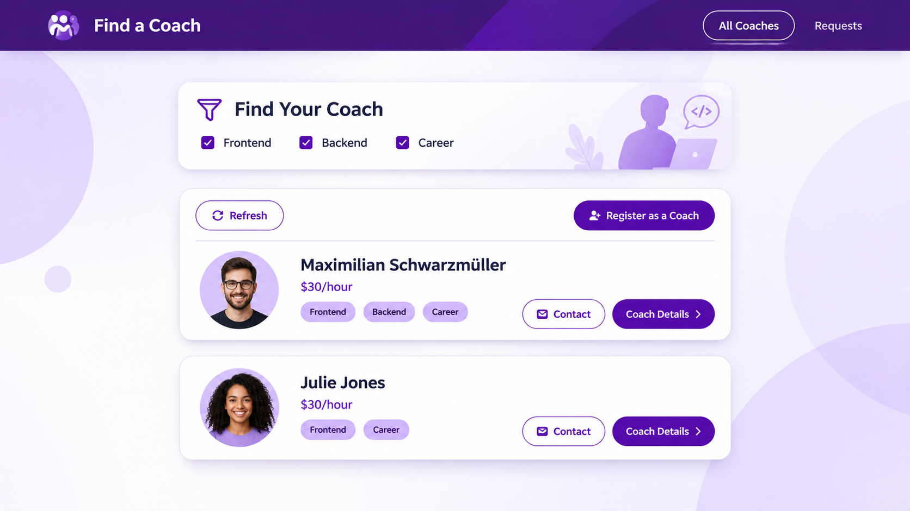

# Vue Practice 2026 – Find a Coach

A hands-on Vue.js learning project developed while following the Udemy course **Vue - The Complete Guide (incl. Router & Composition API)** by Maximilian Schwarzmüller.

The project involves building a coaching platform where users can discover coaches, filter by areas of expertise, view coach profiles and connect with potential mentors.

It forms part of my ongoing journey to strengthen my frontend development skills through practical implementation, experimentation and problem-solving.

---

## 🖥️ Application Preview



_Find a Coach – a redesigned visual concept for the tutorial application._

---

## 📖 About the Project

**Find a Coach** is a guided learning application developed as part of my Vue.js studies.

The application allows users to explore available coaches across different professional categories:

- Frontend Development
- Backend Development
- Career Development

Through this project, I am gaining practical experience with Vue.js and learning how to build interactive, component-based applications.

The project also provides an opportunity to understand how different parts of a frontend application work together, including components, routing, state management, forms and user interaction.

While following the course, I have also been working through development challenges, troubleshooting errors and improving my understanding of the underlying technologies.

---

## 🎓 Learning Resource & Acknowledgement

This project is based on concepts and practical exercises from the following Udemy course:

**Vue - The Complete Guide (incl. Router & Composition API)**

- Instructor: Maximilian Schwarzmüller
- Platform: Udemy
- Course: [Vue - The Complete Guide (incl. Router & Composition API)](https://www.udemy.com/course/vuejs-2-the-complete-guide/)

The original course provides structured instruction and practical exercises covering Vue.js, its ecosystem and frontend application development.

**Acknowledgement:** Credit goes to Maximilian Schwarzmüller for the educational content and guidance provided through the course. This repository represents my personal learning and implementation work and is not an official course repository.

---

## ✨ Application Features

The Find a Coach application explores the following functionality:

### 1. Find a Coach

Users can browse available coaches and explore their professional expertise.

The application focuses on three coaching categories:

- Frontend Development
- Backend Development
- Career Development

### 2. Coach Profiles

Coach listings display relevant information, including:

- Coach name
- Hourly rate
- Areas of expertise
- Contact option
- Coach details option

### 3. Filter Coaches

Users can select their preferred coaching categories to filter the available coaches according to their interests.

### 4. Register as a Coach

Individuals can register as coaches and make their professional expertise available to other users.

### 5. Contact Coaches

Users can initiate contact with coaches through the application's contact functionality.

### 6. Coaching Requests

The application includes a Requests section for accessing coaching requests.

---

## 🛠️ Technologies Used

The project uses the Vue 2 ecosystem and supporting frontend development tools.

| Technology        | Purpose                       |
| ----------------- | ----------------------------- |
| Vue.js 2.7.16     | Frontend JavaScript framework |
| JavaScript (ES6+) | Application functionality     |
| HTML5             | Application structure         |
| CSS3              | Styling and layouts           |
| Vue Router 3.6.5  | Client-side navigation        |
| Vuex 3.6.2        | Centralised state management  |
| Vue CLI 4         | Development and build tooling |
| Babel             | JavaScript transpilation      |
| ESLint            | Code quality and linting      |
| npm               | Package management            |

**Version compatibility:** This repository currently uses Vue 2.7.16, Vue Router 3.6.5 and Vuex 3.6.2. These dependencies belong to the Vue 2 ecosystem.

Although the Udemy course covers additional Vue.js topics, including the Composition API, this particular project should be understood in the context of its installed dependencies and implementation.

---

## 📚 Vue.js Concepts Practised

This project provides practical exposure to important Vue.js concepts.

### 1. Vue Components

Vue components allow developers to divide an application into smaller, reusable and independent pieces.

Vue Single File Components (`.vue`) typically contain three sections:

```vue
<template>
  <!-- HTML structure -->
</template>

<script>
export default {
  // Component logic
};
</script>

<style>
/* Component styling */
</style>
```

### 2. Props

Props allow parent components to pass data to child components.

Example:

```vue
<coach-item :title="coach.name" :type="coach.areas" />
```

The child component receives the information through its props:

```javascript
export default {
  props: {
    title: {
      type: String,
      required: true,
    },
    type: {
      type: Array,
      required: true,
    },
  },
};
```

### 3. Computed Properties

Computed properties allow developers to derive values from existing reactive data.

Example:

```javascript
computed: {
  text() {
    return this.title
      ? this.title.toUpperCase()
      : "";
  }
}
```

Vue automatically updates computed properties when their dependencies change.

### 4. Custom Events

Custom events allow child components to communicate with their parent components.

Example:

```javascript
this.$emit("select-coach", this.id);
```

This allows components to communicate without directly modifying their parent's data.

### 5. Conditional Rendering

Vue provides directives such as `v-if`, `v-else` and `v-show` to conditionally display elements.

Example:

```vue
<p v-if="coaches.length">
  Available coaches
</p>

<p v-else>
  No coaches found.
</p>
```

### 6. List Rendering

The `v-for` directive allows developers to render lists of data dynamically.

Example:

```vue
<div v-for="coach in coaches" :key="coach.id">
  {{ coach.name }}
</div>
```

### 7. Event Handling

Vue uses event listeners to respond to user interactions.

Example:

```vue
<button @click="refreshCoaches">
  Refresh
</button>
```

This allows the application to respond to actions such as button clicks and form submissions.

---

## 🧭 Vue Router

Vue Router manages navigation between different views within a Vue Single Page Application (SPA).

It allows users to navigate between application sections without requiring a full page reload.

Example:

```javascript
const routes = [
  {
    path: "/coaches",
    component: CoachesList,
  },
  {
    path: "/requests",
    component: Requests,
  },
];
```

Navigation can be implemented using `router-link`:

```vue
<router-link to="/coaches">
  All Coaches
</router-link>

<router-link to="/requests">
  Requests
</router-link>
```

The `router-view` component renders the currently selected route.

```vue
<router-view />
```

---

## 🗃️ Vuex State Management

Vuex provides a centralised store for managing shared application data.

It is particularly useful when multiple components need access to the same information.

Vuex consists of four main concepts:

**State**

Stores application data.

```javascript
state: {
  coaches: [];
}
```

**Getters**

Retrieve or calculate values from the store.

```javascript
getters: {
  getCoaches(state) {
    return state.coaches;
  }
}
```

**Mutations**

Synchronously update the application state.

```javascript
mutations: {
  setCoaches(state, coaches) {
    state.coaches = coaches;
  }
}
```

**Actions**

Handle operations such as asynchronous API requests.

```javascript
actions: {
  async loadCoaches({ commit }) {
    // Fetch coach information
    // Commit the retrieved data
  }
}
```

---

## 🎨 Design and User Experience

The application uses a clean and professional visual direction.

The redesigned homepage concept explores:

- Deep purple as the primary brand colour.
- Violet and lavender as accent colours.
- White backgrounds for readability.
- Modern sans-serif typography.
- Rounded cards and buttons.
- Consistent spacing and alignment.
- Clear visual hierarchy.
- Improved presentation of coach profiles.

The visual concept is intended to inspire further UI improvements while maintaining the application's original purpose and functionality.

---

## 🚀 Getting Started

Follow the instructions below to clone and run the project locally.

### Prerequisites

Make sure you have the following installed:

- Node.js
- npm (Node Package Manager)
- Git

### 1. Clone the repository

```bash
git clone https://github.com/Paris2020/vue-prac-2026.git
```

### 2. Navigate to the project directory

```bash
cd vue-prac-2026
```

### 3. Install dependencies

```bash
npm install
```

### 4. Start the development server

```bash
npm run serve
```

Once the development server starts, open the local URL provided in your terminal.

The default Vue CLI development URL is:

```text
http://localhost:8080
```

---

## 📜 Available Scripts

| Command         | Description                            |
| --------------- | -------------------------------------- |
| `npm run serve` | Starts the local development server    |
| `npm run build` | Builds the application for production  |
| `npm run lint`  | Checks the codebase for linting issues |

### Building for Production

To create a production-ready build, execute:

```bash
npm run build
```

The generated production files will be available in the `dist` directory.

---

## 🎯 Learning Objectives

The main learning objectives of this project include:

1. Strengthening Vue.js fundamentals.
2. Understanding component-based architecture.
3. Practising parent-child component communication.
4. Working with props and custom events.
5. Implementing dynamic rendering using Vue directives.
6. Managing navigation with Vue Router.
7. Understanding state management with Vuex.
8. Organising application logic into reusable components.
9. Developing interactive user interfaces.
10. Improving debugging and problem-solving skills.
11. Understanding the differences between Vue 2 and Vue 3.
12. Exploring modern Vue.js development practices.

---

## 🔮 Future Improvements

Potential enhancements for the application include:

- Improved mobile responsiveness.
- Advanced coach filtering and searching.
- Coach profile image uploads.
- Form validation.
- User authentication and authorisation.
- Improved coach registration workflow.
- Enhanced coaching request management.
- API integration.
- Loading indicators and error handling.
- Unit testing.
- Exploring Vue 3 and the Composition API.

---

## 📌 Project Status

**Status:** Active Learning / Tutorial-Based Development

This repository is part of my ongoing frontend development learning journey.

It will continue to evolve as I work through the Udemy course, practise additional Vue.js concepts, troubleshoot development challenges and experiment with improvements to the application.

---

## 👩‍💻 Author

**Nelly Moseki**

Frontend Developer | Software Development

GitHub: [@Paris2020](https://github.com/Paris2020)

---

## 📄 License

This repository contains personal educational work developed while following an external learning resource.

The original course content and materials remain the property of their respective copyright holders.
